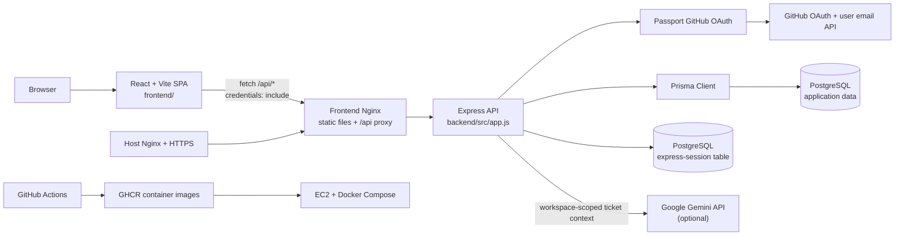
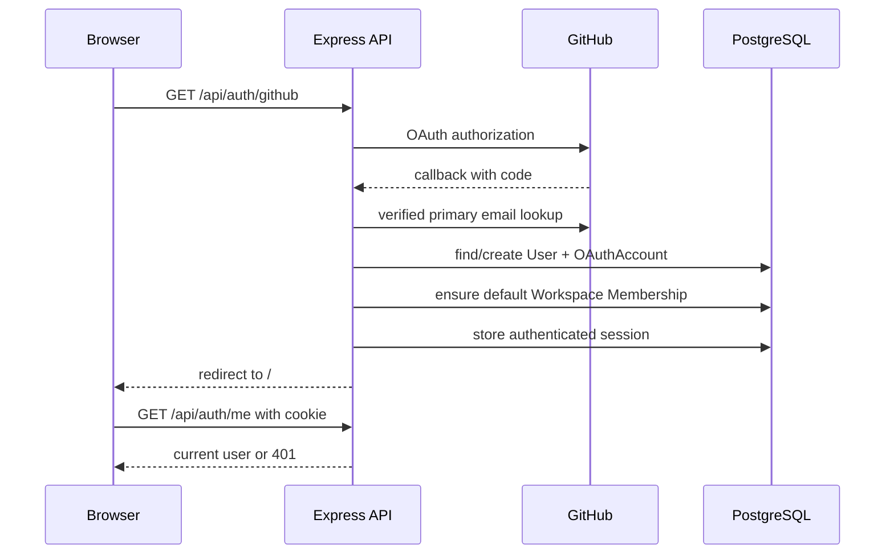
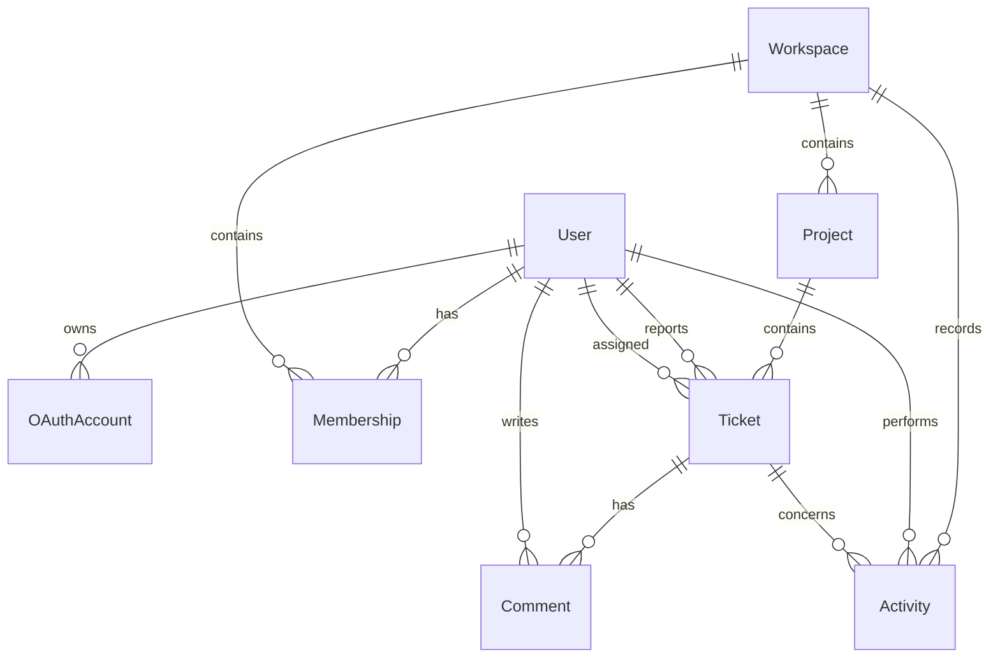
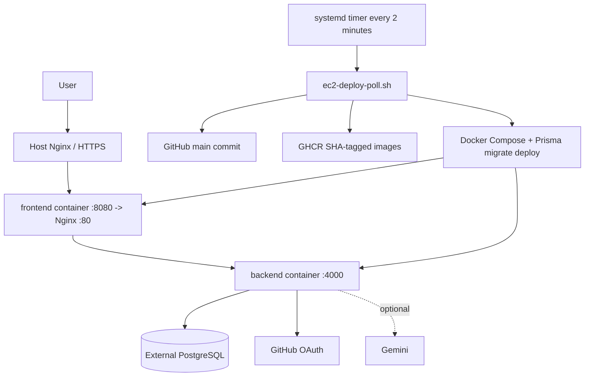

# GFG RBU Workspace Architecture

## 1. System overview

GFG RBU Workspace is a full-stack developer ticketing and collaboration application.
The browser runs a React single-page application, which calls an Express API. The API
authenticates users with GitHub OAuth, stores sessions in PostgreSQL, and uses Prisma
for workspace, project, ticket, comment, activity, and membership data.



## 2. Repository map

| Area | Responsibility | Main locations |
|---|---|---|
| Frontend entry and routing | React bootstrapping, React Query, browser routes | `frontend/src/main.tsx`, `frontend/src/App.tsx` |
| Frontend shell and pages | Authenticated layout, navigation, dashboard, tickets, team, activity, settings, help, assistant | `frontend/src/components/layout/AppShell.tsx`, `frontend/src/features/pages.tsx` |
| Frontend API client | Typed request helpers, query keys, request/response types | `frontend/src/lib/workspace-api.ts`, `frontend/src/lib/auth.ts` |
| API bootstrap | Express middleware, sessions, OAuth, health route, error handling | `backend/src/app.js` |
| Workspace API | Authentication/membership guard, validation, authorization, ticket/project/team/activity/assistant routes | `backend/src/api/workspace.js` |
| OAuth account handling | GitHub identity lookup, user creation, default membership | `backend/src/auth/accounts.js` |
| Persistence | Prisma adapter/client and the active data model | `backend/src/database/prisma.js`, `backend/prisma/schema.prisma` |
| Database evolution | PostgreSQL migrations | `backend/prisma/migrations/` |
| Local/deployed runtime | Compose services, Dockerfiles, Nginx proxy, EC2 polling deployment | `docker-compose.yml`, `backend/Dockerfile`, `frontend/Dockerfile`, `deploy/` |
| CI/CD | Tests, schema validation, frontend checks, image publication | `.github/workflows/ci-cd.yml` |

## 3. Frontend architecture

`frontend/src/main.tsx` mounts `App` into the browser. `App.tsx` creates one
React Query client and the React Router tree:

```text
/login                         LoginPage
/                             AppShell -> DashboardPage
/tickets                      AppShell -> TicketsPage
/tickets/:ticketId            AppShell -> TicketDetailPage
/team                         AppShell -> TeamPage
/assistant                    AppShell -> AssistantPage
/activity                     AppShell -> ActivityPage
/settings                     AppShell -> SettingsPage
/help                         AppShell -> HelpPage
```

`AppShell` is the authenticated route boundary. It calls
`GET /api/auth/me` through `useCurrentUser`; pending/error states are shown
directly, unauthenticated users are redirected to `/login`, and authenticated
users receive the sidebar, search, profile, logout, and nested page outlet.

Pages use React Query for server state. `workspace-api.ts` centralizes:

- API base URL selection through `VITE_API_URL` (or `http://localhost:4000` locally).
- `credentials: "include"` so the session cookie is sent.
- JSON request headers and consistent API error extraction.
- Query keys and typed calls for workspace, dashboard, projects, tickets, team,
  activity, profile, and the assistant.

After mutations, pages invalidate related query keys so dashboard, ticket, project,
team, and activity views stay synchronized with the API. The browser does not own
the authoritative ticket data; PostgreSQL is the source of truth.

## 4. Backend architecture

`backend/src/app.js` is the composition root:

1. Loads environment configuration and validates required settings.
2. Creates the PostgreSQL pool used by `connect-pg-simple`.
3. Creates the Express app and installs Helmet, CORS, JSON parsing, and sessions.
4. Initializes Passport and defines user serialization/deserialization.
5. Registers GitHub OAuth start/callback routes.
6. Registers `/api/auth/me`, `/api/auth/logout`, and `/api/health`.
7. Mounts `createWorkspaceRouter({ prisma, frontendUrl })` at `/api`.
8. Converts unhandled request errors into JSON responses.

The workspace router applies these guards to every workspace route:

```text
requireAuthentication
    -> find membership for req.user and requested workspaceId
    -> attach req.workspace and req.membership
    -> route-specific role/origin validation
    -> Prisma query/mutation
    -> serialized JSON response
```

State-changing requests additionally require the configured frontend `Origin`.
Project creation and role changes use elevated-role checks; ownership-sensitive
operations are enforced on the server rather than in the UI.

### API surface

| Capability | Routes |
|---|---|
| Authentication | `GET /api/auth/github`, `GET /api/auth/github/callback`, `GET /api/auth/me`, `POST /api/auth/logout` |
| Workspace/profile | `GET /api/workspace`, `GET /api/profile`, `PATCH /api/profile` |
| Dashboard/projects | `GET /api/dashboard`, `GET /api/projects`, `POST /api/projects` |
| Tickets | `GET /api/tickets`, `POST /api/tickets`, `GET/PATCH /api/tickets/:ticketId` |
| Ticket export/comments | `GET /api/tickets/export/completed.csv`, `POST /api/tickets/:ticketId/comments` |
| Team/roles | `GET /api/team`, `GET /api/team/assignees`, `PATCH /api/team/:userId/role` |
| Activity/assistant | `GET /api/activity`, `POST /api/assistant` |
| Health | `GET /api/health` |

Zod schemas validate query strings and request bodies before database operations.
Ticket and comment changes create activity records transactionally. Assistant
requests use only the current workspace's latest ticket context; the Gemini key
is read by the backend and is never exposed to the frontend.

## 5. Authentication and authorization flow



The session cookie is HTTP-only, `SameSite=Lax`, and secure in production. Sessions
are persisted in PostgreSQL through `connect-pg-simple`. Passport serializes only
the application user ID; deserialization reloads the user from Prisma.

An existing email is not silently linked to a new GitHub identity. The backend
returns the explicit `OAUTH_ACCOUNT_LINK_REQUIRED` path instead.

## 6. Data model and ownership



The active schema is `backend/prisma/schema.prisma`:

- `User` stores application identity and relationships.
- `OAuthAccount` maps a provider account to a user.
- `Workspace` and `Membership` provide tenant boundaries and roles (`OWNER`,
  `ADMIN`, `MEMBER`).
- `Project` belongs to a workspace and allocates project-local ticket keys.
- `Ticket` belongs to a project, reporter, and optional assignee; it contains
  lifecycle status, priority, labels, and optional GitHub URL.
- `Comment` belongs to a ticket and author.
- `Activity` records workspace and ticket events with an actor.

Most workspace queries first scope through `req.workspace.id`, preventing a
member from reading or mutating another workspace's records.

## 7. Runtime and deployment architecture

### Local development

```text
Vite :5173
  -> browser fetches API at VITE_API_URL
Express :4000
  -> Prisma adapter
PostgreSQL
```

Run Prisma migrations/generation and the backend from `backend/`; run Vite from
`frontend/`. The backend requires `DATABASE_URL` and `SESSION_SECRET`. GitHub
OAuth and Gemini are optional/configuration-dependent features.

### Production



GitHub Actions runs backend tests/Prisma validation and frontend lint/build. On
successful pushes to `main`, it publishes immutable commit-SHA images (and
`latest`) to GHCR. The EC2 systemd timer polls for the tested `main` commit,
pulls matching images, runs Prisma migrations, recreates Compose services, and
checks `/api/health`.

The frontend Nginx proxies `/api/` to the backend container and falls back to
`index.html` for SPA routes. PostgreSQL remains external to Compose. Production
OAuth requires HTTPS so secure session cookies and the GitHub callback work
correctly.

## 8. Important maintenance notes

- Treat `backend/prisma/schema.prisma` as authoritative. The
  `backend/src/prisma/schema.prisma` file is an older, inconsistent duplicate
  and is not referenced by the Dockerfile, Prisma config, or migration commands.
- Keep OAuth secrets, `SESSION_SECRET`, `DATABASE_URL`, and `GEMINI_API_KEY` in
  backend environment configuration only.
- Review and back up PostgreSQL before deploying schema migrations.
- Invitations, richer settings, rate limiting/usage quotas, and broader
  production operations are documented as future work in the repository README.

